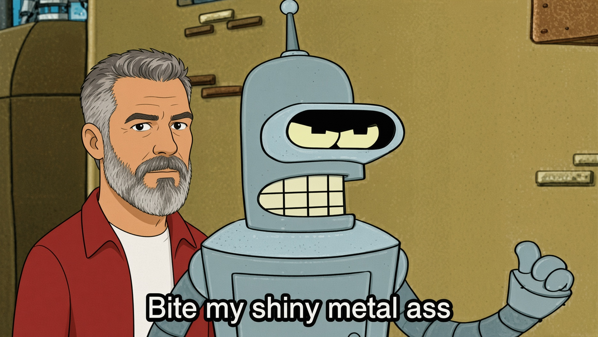

# Magic

A macOS menu bar app that plays a video in a borderless overlay when a global
hotkey is pressed, and removes the overlay the instant the video ends. Each
video can have its own hotkey, managed in a Settings window.

Audience: anyone building, running, or extending the app.

## Build and run

```bash
./scripts/build-app.sh     # produces dist/Magic.app
open dist/Magic.app        # menu bar icon appears; default hotkey is ⌃⌥M
swift test                 # unit tests for the config and hotkey model
make help                  # all task-runner targets
```

Requires macOS 14+ and the Xcode toolchain. The build script ad-hoc signs the
app for local use; it is not notarized.

## Usage

- **Hotkey**: press ⌃⌥M (default) to play. Pressing it again while the video
  plays stops it.
- **Menu bar icon**: play any clip manually, open Settings, or quit.
- **Settings**: add or remove videos, choose files, record a shortcut per video,
  and set the display size. Changes apply immediately. In the recorder, Esc
  cancels and Delete clears the shortcut. A shortcut needs at least one of ⌘, ⌃
  or ⌥, and two videos cannot share one.
- **Display**: the video is centered on the screen under the mouse pointer, at
  its native size times the Size setting (default 2×), shrunk to fit if needed.

Settings are stored at `~/Library/Application Support/Magic/config.json`. On
first launch the bundled video is copied to
`~/Library/Application Support/Magic/Videos/`. An unreadable config is moved
aside as `config.json.corrupt` and the app starts with defaults.

## Video formats

macOS plays H.264 or HEVC in MP4, MOV or M4V. It cannot play MKV or WebM, and an
`.mp4` file is not enough on its own: the codec inside must be supported.
Settings reports the detected codec when a file cannot be played.

Common problems:

- **Fragmented MP4** (raw YouTube DASH, `.f134.mp4`): AVFoundation reports
  double the real duration, so the overlay lingers. Remux it (lossless).
- **VP9 or AV1** in MP4 or WebM (`.f616.mp4`, `.webm`): AVFoundation cannot
  decode it. Re-encode to H.264.
- **Video and audio in separate files** (YouTube downloads): merge them while
  converting.

Remux a fragmented file:

```bash
ffmpeg -i input.mp4 -c copy -movflags +faststart output.mp4
```

Re-encode VP9 video and merge a separate audio file:

```bash
ffmpeg -i video.mp4 -i audio.webm -map 0:v:0 -map 1:a:0 \
  -c:v libx264 -crf 18 -pix_fmt yuv420p -c:a aac -b:a 160k \
  -movflags +faststart -shortest output.mp4
```

Only `assets/magic.mp4` (remuxed, bundled as the default) is tracked in git.
Other source downloads and converted clips are git-ignored; keep your own
videos anywhere and add them in Settings.

## How it stays fast

- Each clip has its own `AVPlayer`, loaded and prerolled (decoder and buffers
  primed) at launch.
- The overlay window is created up front and kept on screen at alpha 0, so
  showing it is a single alpha change plus `play()`. When playback ends, the
  overlay is hidden and the clip is rewound and prerolled again for the next
  trigger.
- Hotkeys use Carbon `RegisterEventHotKey`, which needs no Accessibility
  permission.
- The overlay never takes keyboard focus from the frontmost app.

## Project layout

| Path                    | Purpose                                   |
| ----------------------- | ----------------------------------------- |
| `Sources/MagicCore/`    | UI-free model: config, hotkey values      |
| `Sources/Magic/`        | App: menu bar, hotkeys, players, Settings |
| `Tests/MagicCoreTests/` | Unit tests for `MagicCore`                |
| `scripts/build-app.sh`  | Builds and assembles `dist/Magic.app`     |
| `assets/magic.mp4`      | Default bundled video                     |
| `Makefile`              | Task runner; run `make help`              |
| `.github/workflows/`    | Manual CI: build, test, lint              |

## Troubleshooting

- **No menu bar icon**: macOS hides a status item when the menu bar is full,
  which is common under a notch. About a second after launch the app detects
  this, shows a Dock icon, and opens Settings. The Dock icon's menu has the same
  entries as the menu bar menu.
- **Hotkey does nothing**: Settings shows a red warning under the video when the
  system or another app already owns the shortcut, or when the file cannot be
  played. Choose a different shortcut or convert the file.
- **Overlay stays after the video ends**: the file is probably a fragmented MP4;
  remux it as shown above.
- **Quit**: use the menu bar icon or the Dock icon menu.

## Development notes

- Avoid `MainActor.assumeIsolated`. It crashed inside the Swift runtime in timer
  callbacks on this toolchain (Swift 6.4, macOS 27); the code hops to the main
  actor with `Task { @MainActor in ... }` instead, and the app starts from an
  `@main` type.
- `AVPlayer.preroll` raises an exception unless the item is `readyToPlay`.
  `ClipPlayer` polls the item's status first, because a Combine KVO stream did
  not deliver the change.
- Inside Claude Code's sandbox, `swift build` and `open` fail with "Operation
  not permitted". Build and launch from a normal terminal.

## Contributing and handover

See [`ENGINEERING.md`](ENGINEERING.md) for architecture, decisions, and
verification status, and [`AGENTS.md`](AGENTS.md) for agent guidance.

## License

[MIT](LICENSE)

## AI Notice

I am a software engineer with nearly 50 years of experience. I now use AI tools to assist me with development. For this project, I have used Claude.ai. After each feature update, I reviewed the application to ensure that it was working as I intended. As someone with Frontotemporal Dementia, AI tools are literally saving my career, and allowing me to continue working longer in a field that I love. If you don't like AI, you are welcome to not use my application.

If you do not like that I use AI, tough. In the words of Bender:


